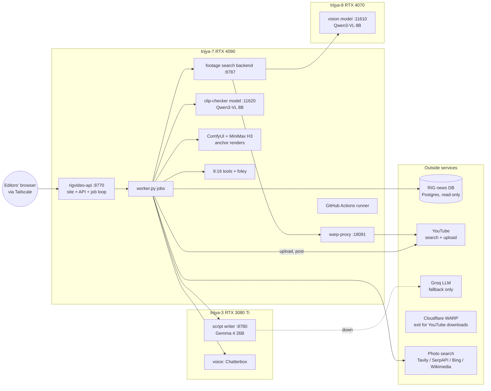
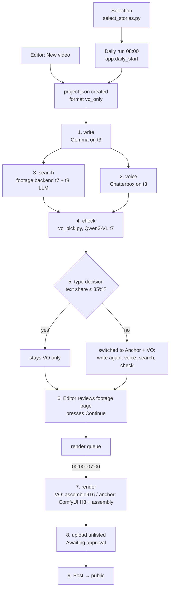

# RIG-Video: project handoff

> **Who this is for:** anyone taking over RIG-Video with no prior context, whether a person or an AI assistant. Read it
> top to bottom once; after that, each section stands on its own.
>
> **Conventions:**
> - All times are **IST** (UTC+5:30). The machines' clocks and logs are in UTC.
> - "t3", "t7" and "t8" mean the machines trijya-3, trijya-7 and trijya-8.
> - Paths starting `~` are in the Linux home directory on that machine.
>
> **Deeper detail:** this file is the map. Every part has a full reference chapter in `docs/reference/`:
> [the website](reference/site.md) · [the API, storage, writer and LLM pool](reference/api.md) ·
> [the machine jobs (`worker.py`)](reference/worker.md) · [the anchor render chain and shared pipeline](reference/anchor-and-shared-pipeline.md) ·
> [VO-only, footage search, machines and operations](reference/vo-footage-ops.md).

---

## Contents

1. [What RIG-Video is](#1-what-rig-video-is)
2. [The system at a glance](#2-the-system-at-a-glance)
3. [A day in production](#3-a-day-in-production)
4. [The life of one story, step by step](#4-the-life-of-one-story-step-by-step)
5. [How an anchor video is rendered](#5-how-an-anchor-video-is-rendered)
6. [How a voice-over (VO only) video is made](#6-how-a-voice-over-vo-only-video-is-made)
7. [The website (what editors use)](#7-the-website-what-editors-use)
8. [Data: where everything is stored](#8-data-where-everything-is-stored)
9. [The code: repository map](#9-the-code-repository-map)
10. [Runtime: interpreters, models and third-party installs](#10-runtime-interpreters-models-and-third-party-installs)
11. [Configuration and secrets](#11-configuration-and-secrets)
12. [Restarts and self-recovery](#12-restarts-and-self-recovery)
13. [Shipping changes: CI/CD and releases](#13-shipping-changes-cicd-and-releases)
14. [Operating it: runbook](#14-operating-it-runbook)
15. [Rules: always, and never](#15-rules-always-and-never)
16. [Things on the machines that are NOT RIG-Video](#16-things-on-the-machines-that-are-not-rig-video)
17. [Decisions already made](#17-decisions-already-made)
18. [Glossary](#18-glossary)

---

## 1. What RIG-Video is

RIG-Video turns news articles into short, finished news videos with almost no human work. It belongs to
**RIG 360 Media**, and its first customer is **DNL (Democracy News Live)**, a news site. Videos go to DNL's YouTube channel.

Every day it takes DNL's most important **hard-news** stories (war, conflict, disaster, deaths, democracy, unrest,
terrorism, corruption; never sports or entertainment) and does the rest itself:
- writes a script from each article;
- reads it out with a cloned news-reader voice;
- finds real footage of the event on YouTube and picks the right shots;
- builds the video;
- uploads it to YouTube **unlisted**, so it is not visible yet, for an editor to approve.

Editors work in a web app (the "site"). They check the footage the machine picked, swap anything wrong, and press one
button to send the video to render. The next morning they press **Post** to publish it.

### The three video formats

| Format (code name) | What the viewer sees | Shape | Made by |
|---|---|---|---|
| **VO only** (`vo_only`) | Real footage of the event with a narrator's voice over it, word-by-word captions, a title card and scene sound effects | **9:16 vertical** (1080×1920, a YouTube Short) | `vertical/assemble916.py` (section 6) |
| **Anchor + VO** (`anchor_vo`) | An AI-generated news anchor in a studio speaks some parts on camera. The other parts are footage with the anchor's voice over it. The studio wall behind the anchor shows the story's footage. TV graphics (name tag, headline bar, ticker, logo) and the DNL outro. | **16:9** | ComfyUI (MiniMax H3 model) + `studio-app/pipeline/tools/sourcetrack/` (section 5) |
| **Anchor only** (`anchor_only`) | The anchor speaks the whole story | **16:9** | Same as anchor + VO |

The daily run starts every story as **VO only**. After the footage check, a story that would be mostly text on screen
(the event was not filmed) is switched to **Anchor + VO** automatically (section 4, step 5).

### Who uses it

| Person | What they do |
|---|---|
| **Editors** (DNL newsroom) | Open the site, review the footage per story, press **Continue** (queue the render) and **Post**. |
| **Admin** | Same as editors, plus manages accounts (section 14). |
| **Maintainer** (you) | Keeps the three machines, the code and the releases healthy. |

---

## 2. The system at a glance



### The machines

All three are office Windows PCs running Linux (Ubuntu) inside **WSL2**. They talk over **Tailscale**, a private
network: every address below starts with `100.` and works only inside the tailnet. RIG-Video shares these machines with
other teams' services (section 16). **The machines belong to their owners: RIG-Video runs as a normal user and has no
admin (sudo) rights.**

| Machine | ssh | GPU | RIG-Video's role |
|---|---|---|---|
| **trijya-7** | `trijya-7@100.72.225.89` | RTX 4090 24 GB, power-capped at 250 W by its owner | **The main box.** The website and API, every job, footage search, the clip checker, anchor renders, the final videos, YouTube upload, CI/CD. |
| **trijya-3** | `trijya-3@100.99.155.88` | RTX 3080 Ti 12 GB | The **script writer** (LLM) and the **voice** (text-to-speech). They take turns on its GPU. |
| **trijya-8** | `trijya-8@100.95.0.11` | RTX 4070 12 GB | A **vision model** the footage search uses for its language work, and the clip checker's backup. |

### Services (all `systemd --user`; "boot" = starts by itself after a restart)

| Machine | Unit / process | Port | Boot | What it is |
|---|---|---|---|---|
| t7 | `rigvideo-api.service` | 8770 | yes | The API (FastAPI/uvicorn) that also serves the built website, plus the **job loop** (section 4). |
| t7 | `rigvideo-tunnel.service` | — | yes | Cloudflare Tunnel connector: the public link https://rigtvnews.rig360media.com (section 7). Another team's own tunnel on t7 is separate; leave it alone. |
| t7 | `vo-vision.service` | 11620 | yes | llama.cpp serving **Qwen3-VL 8B Q8**, the clip checker's eyes. Sleeps after 10 idle minutes and wakes on the next call. |
| t7 | `warp-proxy.service` | 127.0.0.1:18091 | yes | SOCKS5 proxy out through **Cloudflare WARP**. YouTube blocks the office IP, so every YouTube download goes through this. |
| t7 | `actions-runner.service` | — | yes | GitHub Actions self-hosted runner: CI and releases (section 13). |
| t7 | footage backend (`uvicorn app.main`) | 127.0.0.1:8787 | **on demand** | Footage search. The worker starts it when needed (`studio-app/pipeline/tools/footage/start_backend.sh`). |
| t7 | ComfyUI v0.38 | local | **on demand** | Anchor video generation. Started and stopped per render by `run_multi.py`. |
| t3 | `rigvideo-writer.service` | 8780 | **on demand** | llama.cpp serving **Gemma 4 26B-A4B** (the script writer). t7 runs `~/rigvideo/llm/gpu.sh writer` to load it and `gpu.sh voice` to unload it before a voice job. |
| t3 | Chatterbox | — | **on demand** | Text-to-speech. Run per job over ssh from t7: `~/anchor-studio/voice_lab/chatterbox_takes.py`. |
| t8 | `vision-llm.service` | 11610 | yes | llama.cpp serving **Qwen3-VL 8B Q4**. The footage search's language model, and the backup for :11620. Sleeps after 15 idle minutes. |

### Outside services

| Service | Used for | Where configured |
|---|---|---|
| **RIG news database** (Postgres on the RIG Hetzner box, `100.83.67.1`) | Choosing the day's stories. **Read-only user; never write to it.** | `~/.config/anchor-studio/db.env` on t7 |
| **YouTube Data API + yt-dlp** | Searching and downloading footage | footage backend (`footage.env`); `footage/ytdlp_node.sh` |
| **YouTube upload API** (DNL channel) | Upload unlisted, playlists, publish | `~/.config/anchor-studio/youtube.env` on t7 |
| **Cloudflare WARP** (free account) | Exit IP for YouTube downloads | `~/warp/` on t7 |
| **Groq** (`gpt-oss-120b`) | Language model **only when t3 or t8 is down** | `llm.env`, `footage.env` |
| **Tavily / SerpAPI / Bing News / Wikimedia** | Still pictures for a story | `search.env` |

---

## 3. A day in production

| IST | What happens | Where | Who |
|---|---|---|---|
| 00:00 (retried every 30 min until it works) | **Selection.** The day's 10 hard-news stories and 10 reserves are chosen from the RIG news DB. Result: `rigvideo-data/selection/<date>.json`. | t7 + t3 (LLM) | machine |
| 00:00–07:00 | **Render window.** The render queue runs one story at a time (sections 5 and 6). | t7 | machine |
| after each render | **Upload** to YouTube as *unlisted*, into the *Awaiting approval* playlist. | t7 → YouTube | machine |
| ~07:00 | t7 restarts every day (its owner's setting). Everything starts again by itself (section 12). | t7 | — |
| 07:30 | `doctor` health check (section 13). | t7 | machine |
| **08:00** | **Daily run** starts. Each of the 10 picks becomes a 1-minute VO-only story that writes, voices, searches and checks itself (section 4). | t7, t3, t8 | machine |
| through the day | **Editors** open each story's footage page, fix anything wrong, press **Continue** (queues the render). | site | editors |
| any time after its render | Editors press **Post** (or **Post all** on the Desk). The video goes public and into DNL's *Video Bulletin* playlist. | site → YouTube | editors |
| render + 60 min | An **anchor-only** video goes public by itself if nobody posted it sooner. | t7 | machine |
| 23:30 | `doctor` health check before the render window. | t7 | machine |

Editors can also make a story by hand at any time (Desk → *New video*: paste a link or text, or upload a file).

---

## 4. The life of one story, step by step

Everything a story is lives in one folder: `~/anchor-studio/rigvideo-data/projects/<story id>/`, mainly
`project.json` (section 8). The API never does heavy work itself. Each step is a separate process,
`worker.py <job> <story id>`, started by the API or by the previous step. The website polls the API every few
seconds and shows each job's progress line.



### The job loop (`server/app.py`, `monitor()`)

The job loop is a thread inside the API that wakes every 4 seconds. Each time it:
- **reaps jobs:** finds jobs whose process has gone. A job cut off by a restart starts again by itself (section 12).
- **runs the render queue:** inside the render window, if no render is running, it starts the oldest queued one.
- **runs the selection:** if today's selection file does not exist, it runs `worker.py selection`, at most once every 30 minutes.
- **starts the daily run:** after `RIGVIDEO_DAILY_AT` (08:00), once a day (a marker file `rigvideo-data/daily/<date>.json`).
- **posts automatically:** uploads finished videos and publishes anchor-only ones (step 9).

### Step 0: selection (`worker.py selection` → `studio-app/pipeline/orchestrator/select_stories.py`)
- Reads candidate stories from the RIG news DB (read-only), groups reports of the same event, and keeps only hard news (category list plus
  regex rules; sports and entertainment are dropped). It scores events by coverage (at least 8 distinct outlets for a pick),
  freshness and type, and picks **10 + 10 reserves** with diversity caps. An LLM labels and groups the stories (the t3 writer; Groq if t3 is down).
- Output: `selection/<date>.json`, the Desk's "Today's picks".

### Step 0b: the daily run (`app.daily_start`)
- For each of the 10 main picks (not the reserves), it creates a project: format `vo_only`, 60 s, source = the DNL article text, owner = the first admin of the `dnl` workspace, and flag `_autoApprove`.
- It then starts **write**.

### Step 1: write (`worker.step_write` → `server/writer.py`)
- **Model:** Gemma 4 26B on t3, through `store.gpu("writer")`, which runs `~/rigvideo/llm/gpu.sh writer` on t3 to load it. Requests to t3 queue on a lock. A busy t3 is retried for daily stories (10 × 3 min); an editor's own story fails fast with "busy, try later".
- **VO only:** the article becomes **beats**. Each beat has the line to speak, what picture should show, its own YouTube search line, and whether it is event footage or archive. The writer also outputs the date the pictured event happened and one "event" search line for the whole story.
- **Anchor formats:** the script is split into **anchor parts** (`a1, a2…`, spoken on camera) and **VO parts** (`v1, v2…`, footage). Writing also produces the lower-third headline and kicker, the ticker lines, and up to 6 facts.
- **Code checks, not another LLM:** section order and count, the length within ±10%, and names and numbers that must appear in the article. Anything the article does not say gets one rewrite. Up to 3 tries; the best try is kept.
- A daily story's script is **approved by itself**; an editor's own story waits for **Approve script**. Approval starts **voice** and **search** in parallel.

### Step 2: voice (`worker.step_voice`)
- `store.gpu("voice")` unloads the writer on t3, so t3's GPU holds one model at a time. Chatterbox then makes **3 takes per part**
  with the story's anchor's cloned voice (reference audio in `anchor_registry/voices/`, not in git).
- **Numbers are written out for speech:** "2026" is read "twenty twenty-six", and "%" is read "per cent".
- **Best take:** chosen by word accuracy (faster-whisper transcribes each take on the CPU) and, for anchor parts, by how well it fills whole video shots.
- **Re-voicing:** the editor types what should change, for example "slower", "more serious", "Lipetsk is LEE-petsk" or "pause before the last line"; `worker.asked()` turns it into settings.
- The anchor's speaking pace is learned from every take (`rigvideo-data/calibration.json`); the writer uses it to size lines.

### Step 3: footage search (`worker.step_search`)
- **Backend:** the vendored *footage search backend* (`footage/`, "Live Cutter") on t7:8787. It searches YouTube with the Data API plus yt-dlp, reads captions (or transcribes with Whisper if captions are refused), and uses an LLM (Qwen3-VL on t8:11610; Groq fallback) to find the **moments** in each video that match the text. Each moment gets a relevance score.
- **VO only:** one footage project per beat. The search lines are:
  - the beat's line, filtered to videos uploaded no earlier than 3 days before the event (`after:YYYY-MM-DD`);
  - on the first event beat, also the whole-event line;
  - each line asks for up to 10 videos (`limit:10`).
  - If a beat finds fewer than 2 videos, its rare names are re-spelled the way found titles spell them (articles misspell), and it searches again.
- **Anchor formats:** one footage project per VO part. Each found video is downloaded whole (≤720p, ≤20 min, no live streams). Its moments are cut into clips only when an editor places them (the `cut` job; `clean_shots.py` splits shots and rejects presenters, graphics, maps and vertical video). The story's **picture pool** is searched once (`orchestrator/assets.story_pictures`: captioned news photos naming the story) and shared out per part.
- **YouTube blocking:** the office IP is blocked by YouTube ("Sign in to confirm you're not a bot"). Every download goes through `footage/ytdlp_node.sh`, which uses the WARP proxy when it answers and Node 22 for YouTube's JavaScript checks. If YouTube still refuses, the job stops with a clear message and writes `rigvideo-data/youtube_blocked`.

### Step 4: clip check (`worker.step_check` → `studio-app/pipeline/tools/footage/vo/vo_pick.py`)
- **When:** after the voices exist (their exact length and word timings decide the cuts).
- **What it does:** downloads every found video at 480p (cache `~/vo_check/cache`) and runs six steps:
  1. **gate:** split into camera shots and drop repeats;
  2. **rank:** SigLIP-2 matches each beat's line and wanted picture against every shot;
  3. **pick:** Qwen3-VL on t7:11620 (t8:11610 if t7's is down) sees the top candidates side by side and chooses 1–3 shots in order, rejecting unusable kinds (presenter, studio, promo, maps, text cards);
  4. **assemble:** fills each beat's exact length, cutting on the voice's phrase breaks; a beat short of footage gets the story's own pictures;
  5. **review:** one look at the finished edit swaps misfits;
  6. **enforce:** no repeats too close together.
  It also suggests a **scene sound** per shot: a foley prompt, or none for static scenes.
- **Output:** the **edit**, which shots play under each beat, when and for how long.
  - `p["edit"]` for VO only.
  - `p["anchorEdit"]` for anchor + VO: the shots for the VO parts. Assembly uses it wherever an editor placed nothing.
- **Machine safety:** the check holds the shared `search.lock`, so it never runs beside a render.

### Step 5: type decision (daily stories only, once; `worker.decide_type`)
If more than 35% of the edit is text on screen (documents, social posts), or a beat runs short of pictures, the event
was not really filmed. The story is then switched to **Anchor + VO** (`store.switched`): it is written again with anchor parts,
then voiced, searched and checked again. The reason is recorded and shown to editors. Editors can also switch the
format by hand.

### Step 6: the editor (site)
- **VO only, footage page:** the editor plays the edit, swaps shots for other candidates, removes or reorders them, adjusts the **Sound** prompt, and checks a beat again.
- **Anchor formats, Visuals page:** per part, the editor sees keywords, found videos and moments, photos, and their own uploads, and places what plays.
- **Continue** (`POST /api/projects/<id>/render`) puts the story in the **render queue**. Outside 00:00–07:00 it shows "Starts at 00:00 IST".

### Step 7: render (`worker.step_render`)
VO only → section 6. Anchor formats → section 5. One render at a time, only in the render window.

### Step 8: upload (job loop → `worker.step_post … upload`)
When a render is done, the video uploads to the DNL YouTube channel **unlisted** and is added to the
**Awaiting approval** playlist (`orchestrator/publish.py`). The YouTube video id is saved immediately, so a retry never
uploads twice.

### Step 9: post
- **Post** / **Post all** (site), or DNL's CMS *Approve* (same effect): the video becomes **public**, moves to the
  **Video Bulletin** playlist, and leaves *Awaiting approval*. If the title or description was edited in the Post dialog, it is updated first.
- An **anchor-only** video is posted by itself 60 minutes after its render (`RIGVIDEO_AUTO_PUBLISH_MIN`).
- VO-only videos are uploaded as **Shorts** (9:16); anchor videos as normal videos (16:9).

---

## 5. How an anchor video is rendered

**Entry:** `worker.step_render` (anchor formats). Output: `media/final.mp4` (16:9). About **8 minutes of GPU per anchor
appearance**, with 3 appearances in a typical story.

1. **Appearance masters** (`prepare_render`): on **t3** (its ffmpeg has Rubber Band), `make_appearances.py` +
   `make_master.py` time-fit each anchor part's chosen take, keeping pitch and stretching at most ±9%. Each part then fills whole
   **328-frame shots** exactly (24 fps; 39 frames of context overlap between shots). Each anchor part is its own
   *appearance*, rendered **independently** from a fresh seed and never chained to another.
2. **ComfyUI jobs** (`build_st.py` → `build_main.py`, recipe **"t8k"**): per appearance, a *seed* job and a *chain* job for further shots, both
   on the speed path (`--turbo-seed`: 8 steps with the Acc-8Step LoRA, FirstBlockCache + sparse attention). The workflows come from
   `studio-app/pipeline/templates/*.json`. The anchor's face (`anchor_face_<id>.png` or `anchor_id_<id>.png`, from `anchor_registry/frames/`) and the chain's fixed reference `anchor_ref_v12.png` are read from ComfyUI's `input/` folder; the studio plate
   from `bg_options/`, and the voice is locked to the master audio (*source_track*: the anchor lip-syncs to our TTS voice;
   H3 does not invent a voice).
3. **GPU run** (`run_multi.py`):
   - Waits for any footage search or check to finish (`search.lock`).
   - **Pauses other teams' GPU services on t7** (`orchestrator/gpu.py`: `ollama-robin`, `pt-worker-box-gpu`, `collect-ollama`, `vo-vision`) only if something holds the GPU, and schedules a separate systemd timer that restores them 5 h later no matter what.
   - Starts ComfyUI once, renders every appearance, then kills ComfyUI and restores the services.
   - The anchor's pictures must already be in `~/anchor-studio/repos/ComfyUI-v038/input/`. **`deploy.sh` does not copy them, nor `comfy_nodes/`:** a new anchor's face and any custom-node change are copied there by hand.
4. **Lip-sync check** (`lipsync_check.py`): if the mouth lags the voice by more than 2 frames, the render is **held** and an
   editor decides.
5. **Assembly** (`worker.step_assemble` → `assemble_story.py`):
   - **VO parts:** the editor's placed footage, else the clip checker's picks (`anchorEdit`), downloaded at source quality, laid under the voice.
   - **The studio wall** behind the anchor plays **the last footage shot the viewer saw before that anchor part**. The opening anchor part shows the first shot that follows it. `colorlock.py` + `wall_comp.py` composite it onto the wall.
   - **Graphics** (`studio-app/lt_remotion`, a Node/Remotion package): anchor name tag (first appearance only), headline lower third, ticker, location, logo. These appear only over anchor shots, never over footage.
   - The **DNL outro** closes the video. The whole mix ends at −14 LUFS.

---

## 6. How a voice-over (VO only) video is made

**Entry:** `worker.render_vo` → `step_final` → `vertical/assemble916.py <project dir> <work dir> <project.json>`.
Output: `media/final_916.mp4` (1080×1920, 24 fps). There is no GPU hold; foley runs with model offload if the GPU is busy.

For each cut in the edit:
1. **Download at source quality.** The range is downloaded at up to 1080p, with 4 s spare each side (`assemble916.download`). If YouTube refuses, it falls back to the checker's 480p copy, and that cut is marked "low".
2. **Reframe to vertical** (`vertical/vconv.py`). It uses five open models: TransNetV2 for cuts, RF-DETR for people and objects, YuNet for faces, UNISAL for saliency, and RapidOCR for text. Per shot it picks one layout:
   - **LOCKED**: a steady crop;
   - **TRACK**: the crop follows the subject, smoothly;
   - **FIT**: the whole frame over a blurred copy;
   - **PASS**: the shot is already vertical;
   - **SPLIT**: two people far apart, stacked;
   - **SWEEP**: a still with a slow push-in.
   Text cut by the crop edge is blurred.
3. **Crop check** (`vertical/cropcheck.py`): the vision model compares the original and vertical frames at the shot's key moment. If what the shot was picked for is lost, the cut is redone as FIT. Text shots always use FIT.
4. **Sound** (`vertical/sound916.py`): shots with a sound prompt get scene sound from **HunyuanVideo-Foley XL** (`~/foley` on t7). It sits 12 dB under the voice for loud scenes and 24 dB for quiet ones. The first sound leads in 1.5 s before the voice, and there are up to 2 "sound-ups" at beat boundaries. Nothing comes from the source clips' own audio, and there is **no music**.
5. **Graphics** (`vertical/gfx916.py`): word-synced captions, the headline title card at the start, and quote cards. No credits. Burned in with libass.
6. One encode joins the shots under the beat voices and normalises loudness.

The final video is rebuilt automatically whenever the edit or a picked voice changes (`store.final_fp`).

---

## 7. The website (what editors use)

React + Vite + TypeScript (`web/`). It is built into `~/anchor-studio/rigvideo/dist` and served by the API.

- **Public link (editors): https://rigtvnews.rig360media.com.** A Cloudflare Tunnel named **Rigtvnews** in the org's
  Cloudflare account (Networking → Tunnels) carries it to t7. `rigvideo-tunnel.service` (t7, starts on boot) runs the
  connector with the token in `~/.config/rigvideo/tunnel.token`. In Cloudflare the tunnel has one published-application
  route, `rigtvnews.rig360media.com` → `http://100.72.225.89:8770`. **It must not say `localhost`:** the API listens only on
  the Tailscale address, and `localhost` gives a 502. Cloudflare made the DNS record (a CNAME to the tunnel) itself.
- **Inside the office network:** http://100.72.225.89:8770 (Tailscale only).
- **Sign-in protection:** every page except the landing, sign-in and `/api/health` needs an account, media files included.
  Five wrong passwords in 15 minutes lock that email and that address for 15 minutes (`app.login`; in memory, so a
  restart clears it). The session cookie is marked Secure when the visit is over HTTPS. The site talks only to `/api/*`, `/files/*` and
`/anchor-media/*`. For local development, `npm run dev` in `web/` proxies those paths to the API (`RIGVIDEO_API` picks another one).

| Page | Path | What it is for |
|---|---|---|
| Landing | `/` | The public face of the product (scroll story). |
| Sign in | `/signin` | Email + password. There is no sign-up yet; accounts are made by an admin (section 14). |
| **Desk** | `/desk` | Home. New video (link, text or file), Today's picks, In progress, Needs you, Just finished, Ready to post, **Post all to YouTube**. |
| **Script** | `/story/<id>/script` | Script per format, anchor choice, lower third, ticker, facts, AI *Rewrite* ("what should change?"), **Approve script**. |
| **Visuals** | `/story/<id>/visuals` | VO only: **the edit** (per beat: cuts, swap, remove, reorder, *Sound*, *Check again*). Anchor formats: per part keywords, found videos and moments, photos, uploads, maps, placement. Type chip and switch. **Continue** queues the render. |
| **Review** | `/story/<id>/review` | Play the story. Per part: listen and *Make a new take* with a note. Extras (outro). The final video. Queue position. **Post to YouTube** (title and description editable). |
| Library | `/library` | Finished videos: download, *Make another from this*. |
| Anchors | `/anchors` | The 10 AI anchors, their regions and pace. |
| Settings | `/settings` | Defaults and connected accounts. |

**Workspaces:** one, `dnl`. The daily run's stories belong to the first `dnl` admin.

**Anchors** (`studio-app/anchor_registry/registry.json`): 10 anchors are ready.
- Each has a face (`frames/`), a voice reference (`voices/`, not in git), regions it covers (`affinity`), and a measured pace.
- A story gets the first ready anchor whose region matches the story's country (`app.pick_anchor`).
- `rohit` is still being added (status `onboarding`) and is not offered.

**API:** all routes are in `server/app.py` (`/api/login`, `/api/desk`, `/api/projects/...` for create, save, approve,
switch, retry, revoice, rewrite, keywords, moments, uploads, maps, render, final, post, cancel, and move up;
`/api/post-all`, `/api/daily/start`, `/api/health`). Every route except login and health needs a signed-in session.

---

## 8. Data: where everything is stored

There is no database. Everything is **JSON files and media on t7** under `~/anchor-studio/rigvideo-data/` (env `STUDIO_DATA`).
Every read-modify-write of a project holds a file lock, so the API and the workers never overwrite each other.

| Path | What |
|---|---|
| `projects/<id>/project.json` | One story (shape: `web/src/data/types.ts`; keys starting `_` are server-only). See the fields below. |
| `projects/<id>/log.txt` | That story's step log (every job's output). **First place to look when something fails.** |
| `projects/<id>/voice/` | Voice takes |
| `projects/<id>/media/` | Pictures, clips, edit previews, `final_916.mp4` (VO), `final.mp4` (anchor), posters |
| `projects/<id>/check/`, `check_anchor/` | Clip checker input and output (`edit.json`) |
| `projects/<id>/final916/` | VO final build work folder (`build.json`: how each cut was made) |
| `projects/<id>/render/` | Anchor render: appearances, ComfyUI outputs, `assembly/` |
| `selection/<date>.json` | That day's picks (with the full scoring audit). `selection/log.txt` = selection log. |
| `daily/<date>.json` | Marker: the daily run started, and which stories it made |
| `users.json` | Accounts (scrypt password hashes), mode 600 |
| `session.key` | Signs sign-in sessions (made on first start) |
| `prefs/<user>.json` | Per-user defaults and hidden picks |
| `calibration.json` | Learned speaking pace per anchor |
| `*.lock` | `search.lock` (searches and checks shared; render exclusive), `voice.lock`, `t3gpu.lock`, `writer.lock` |
| `footage_backend.log`, `youtube_blocked` | Footage backend start log; last YouTube refusal |

Other data on t7: `~/vo_check/cache/` (480p copies for the checker), `~/anchor-studio/footage/data/` (footage backend).
On t3: `~/anchor-studio/studio/<id>/` (voice jobs).

**Main `project.json` fields:**

| Field | Meaning |
|---|---|
| `id`, `headline`, `createdAt` | Identity |
| `format` | `vo_only`, `anchor_vo` or `anchor_only` |
| `stage` | `script`, `visuals`, `review` or `done` |
| `source` | The article: `{kind: link\|text\|file, url, text}` |
| `targetSeconds` | Asked length |
| `anchorId` | The anchor |
| `versions[format]` | The parts or beats: `{id, kind: anchor\|vo, text, voice: {state, takes, pick}, picture, search, cls}` |
| `visuals[part]` | Search results per part: `{keywords, found, photos, uploads, maps, placed}` |
| `edit` / `anchorEdit` | The clip checker's edit, with the editor's changes |
| `lt`, `ticker`, `facts` | On-screen graphics text (anchor formats) |
| `render` | `{state: queued\|rendering\|assembling\|done\|failed\|held, percent, heldReason}` |
| `final` | `{state, video, poster, seconds, fp}` |
| `posts.youtube` | `{videoId, url, state: awaiting\|posted\|failed, queued}` |
| `_jobs[job]` | Running or failed jobs: `{state, progress, note, error, os_pid, resumes}` |
| `_daily`, `_pick`, `formatWhy` | Daily-run origin and the reason for its format |

---

## 9. The code: repository map

Repository: **https://github.com/RIG-360-MEDIA/rig-video** (public; contains no secrets).
`main` is what the next release installs. The folder layout mirrors where each part runs:

```
rig-video/
├── server/                         -> t7 ~/anchor-studio/rigvideo/server
│   ├── app.py          API + job loop + website hosting (FastAPI)
│   ├── worker.py       every machine job: write, voice, search, check, cut, final, render, post, selection
│   ├── store.py        project storage, locks, accounts, sessions, render window, format switch
│   ├── writer.py       script prompts, JSON schemas, code checks; talks to the writer model
│   └── test_*.py       self-tests (run by CI)
├── web/                            -> built into t7 ~/anchor-studio/rigvideo/dist
│   ├── src/pages/      Landing, SignIn, Desk, Script, Visuals, VoEdit, Review, Library, Anchors, Settings
│   ├── src/data/       types.ts (the Project shape), store.ts (API client)
│   └── DESIGN.md      the design system
├── studio-app/                     -> t7 ~/anchor-studio/studio-app
│   ├── pipeline/
│   │   ├── orchestrator/  select_stories (picks), llm (LLM pool), assets (story pictures), publish + youtube_auth
│   │   │                  (YouTube), gpu (pause/restore other teams' GPU services), comfy (ComfyUI client),
│   │   │                  post (wall + graphics), common (paths, env)
│   │   ├── build_main.py + templates/   ComfyUI workflow builder for the anchor (recipe t8k)
│   │   ├── comfy_nodes/                  our ComfyUI custom nodes (installed into ComfyUI's custom_nodes)
│   │   └── tools/
│   │       ├── sourcetrack/   anchor render chain: make_appearances, make_master, build_st, run_multi,
│   │       │                  lipsync_check, assemble_story (+ assemble_hybrid / assemble_novo helpers)
│   │       ├── footage/       start_backend.sh (starts the footage backend), clean_shots.py (labels anchor
│   │       │                  footage cuts), vo/vo_pick.py (THE clip checker)
│   │       ├── voice_lab/chatterbox_takes.py   -> t3 ~/anchor-studio/voice_lab (voice takes)
│   │       ├── new_anchors/runlib.py           GPU helpers used by run_multi
│   │       └── colorlock.py, wall_comp.py      studio-wall compositing
│   ├── anchor_registry/  registry.json + frames/ (faces). Voices and videos are not in git.
│   └── lt_remotion/      TV graphics package (Node/Remotion). node_modules is not in git (npm ci).
├── vertical/                       -> t7 ~/anchor-studio/vertical   9:16 final: assemble916, vconv, cropcheck,
│                                                                  sound916, gfx916
├── footage/                        -> t7 ~/anchor-studio/repos/social_verifier
│   ├── backend/        footage search backend (vendored, see footage/UPSTREAM.md)
│   └── ytdlp_node.sh   the yt-dlp wrapper EVERY YouTube download uses (Node 22 + WARP)
├── hosts/
│   ├── t7/  systemd units (rigvideo-api, rigvideo-tunnel, vo-vision, warp-proxy, actions-runner), vo_vision_serve.sh,
│   │        requirements/*.txt (exact package lists of the 4 Python environments)
│   ├── t3/  gpu.sh (writer/voice switch), rigvideo-writer.service, setup_writer.sh, setup_voice.sh,
│   │        chatterbox-requirements.txt
│   └── t8/  vision-llm.service, vision/vision_serve.sh, vision/deploy_recv.sh (deploy receiver)
├── deploy/   check.sh (the gate), deploy.sh (install a release on t7/t3/t8)
├── ops/      doctor.py (is everything up?)
├── config/   env.example.md (every secret file and variable, by name only)
├── .github/workflows/   ci.yml (check), release.yml (deploy), doctor.yml (daily health)
└── docs/     this file; reference/ (deep chapters per part); design/ (checker criteria, script rulebook, recipe notes)
```

**Which Python runs what (on t7):**

| Code | Interpreter |
|---|---|
| `server/app.py` | `~/anchor-studio/rigvideo-api-venv/bin/python` (FastAPI, uvicorn) |
| `server/worker.py` and every render tool | `~/.cache/anchor-tools/bin/python` (`TOOLS_PY`) |
| `vo_pick.py` (clip checker) | `~/anchor-studio/vertical/.venv/bin/python` (torch, SigLIP-2, RapidOCR) |
| footage backend | `~/anchor-studio/repos/social_verifier/.venv/bin/python` |

All are Python 3.12. The exact package lists are in `hosts/t7/requirements/`.

Some module docstrings still say "TEST" or name an older machine (for example `chatterbox_takes.py` says t8). The code
is what runs: these files are the live path, as listed above.

---

## 10. Runtime: interpreters, models and third-party installs

These are **not in git** because of size. They exist on the machines. To rebuild a machine, reinstall these, then run a
release (section 13).

| What | Where | Size / version |
|---|---|---|
| **ComfyUI** | t7 `~/anchor-studio/repos/ComfyUI-v038` | comfyanonymous/ComfyUI @20ca544 (v0.38) |
| ComfyUI custom nodes | `…/custom_nodes/` | ComfyUI-KJNodes @d3cfe21, ComfyUI-MiniMaxH3-Contex-Loop @93d6bf1, ComfyUI-MiniMaxH3-FirstBlockCache @f7a2712, ComfyUI-VideoHelperSuite @4d907be, our `h3_sparse_override` |
| **MiniMax H3 models** | `…/models/` (52 GB) | `minimax_h3_ref2va_pruned_int8_convrot` (unet), `qwen3vl_32b_minimax_h3_int8_convrot` (text encoder), `minimax_h3_video_vae_fp16`, `minimax_h3_audio_vae_fp32`, LoRAs `MiniMax-H3-Ref2VA-Acc-8Step_pruned_comfy`, `minimax_h3_ref2v_turbo_4step_v0.1` |
| ComfyUI input pictures | `…/input/` | `anchor_face_<id>.png` per anchor + the studio plate. **A render fails if an anchor's pictures are missing here.** |
| Anchor voices and videos | t7 `~/anchor-studio/studio-app/anchor_registry/{voices,videos}` | ~45 MB |
| Studio plate, DNL outro | t7 `~/anchor-studio/studio-app/{bg_options, DNL Outro.mp4}` | 26 MB |
| lt_remotion Node modules | t7 `~/anchor-studio/studio-app/lt_remotion/node_modules` | `npm ci` from the lockfile; Node from `~/.nvm` |
| Clip-checker model | t7 `~/vo_check/models` (Qwen3-VL-8B-Instruct Q8_0 + mmproj F16) + `~/vo_check/src` (llama.cpp @0fb8f15, sm_89) | 10 GB |
| 9:16 models | t7 `~/anchor-studio/vertical/models` (YuNet, UNISAL); TransNetV2, RF-DETR and SigLIP-2 come from pip/HF caches | 85 MB + caches |
| Foley | t7 `~/foley/HunyuanVideo-Foley` (Tencent-Hunyuan @df7b005) + `~/foley/weights` (XL) | 8 GB |
| ffmpeg (shared build) | t7 `~/anchor-studio/repos/ffmpeg-shared/current/bin` (BtbN GPL shared). The static ffmpeg in `~/.local/bin` crashes on network input. | — |
| Node 22 | t7 `~/.nvm/versions/node/v22.23.5` | yt-dlp needs it for YouTube's JS checks; CI builds the site with it |
| YouTube PO-token server | t7 `~/anchor-studio/repos/bgutil-ytdlp-pot-provider` (runs on Node 20, `~/.nvm/versions/node/v20.20.2`, localhost:4416) | Started by `start_backend.sh` with the footage backend; gives caption downloads the token YouTube's own player sends |
| WARP | t7 `~/warp/` (`wgcf`, `wireproxy`, account + WireGuard profile) | free Cloudflare account |
| **Writer model** | t3 `~/rigvideo/llm/models/gemma-4-26B-A4B-it-UD-Q4_K_XL.gguf` + `~/rigvideo/llm/llama.cpp` | 16 GB; rebuild with `hosts/t3/setup_writer.sh` |
| **Chatterbox** | t3 `~/anchor-studio/repos/chatterbox/.venv` + `~/anchor-studio/models/chatterbox` | 3 GB; rebuild with `hosts/t3/setup_voice.sh` |
| **Vision model** | t8 `~/vision/models` (Ollama's Qwen3-VL 8B Q4_K_M blobs) + `~/vision/llamacpp` (llama.cpp @0fb8f15 with CUDA libs) | 7 GB |

---

## 11. Configuration and secrets

**Secrets are never in git.** They live in files with mode 600 on the machines. `config/env.example.md` lists every file
and variable by name. In short (t7):

| File | Holds |
|---|---|
| `~/.config/rigvideo/api.env` | `RIGVIDEO_WRITER_KEY` (shared with t3's `~/rigvideo/llm/api.key`), `RIGVIDEO_DAILY_AUTO=1`, `RIGVIDEO_DAILY_AT=08:00` |
| `~/.config/anchor-studio/db.env` | `ANALYTICS_DB_URL` (RIG DB, read-only user) |
| `~/.config/anchor-studio/youtube.env` | DNL channel OAuth (`YT_CLIENT_ID/SECRET/REFRESH_TOKEN`) + playlist ids. Made once with `orchestrator/youtube_auth.py`. |
| `~/.config/anchor-studio/footage.env` | Footage backend: Groq keys, YouTube Data API key, Google CSE |
| `~/.config/anchor-studio/llm.env` | Groq keys (fallback pool) |
| `~/.config/anchor-studio/search.env` | Tavily, SerpAPI |
| `~/.config/anchor-studio/footage-auth` | Footage backend login password |
| `~/.config/rigvideo/tunnel.token` | Cloudflare Tunnel token for the public link (from the tunnel's page in Cloudflare; rotate there and replace this file) |
| `~/warp/*` | WARP account and WireGuard key |
| `~/.ssh/to_trijya3`, `rigvideo_deploy_t8` | Keys from t7 to t3 (general) and to t8 (forced to `~/vision/deploy_recv.sh`) |

**Settings** (defaults in code; set in `api.env` to change):

| Setting | Default | Meaning |
|---|---|---|
| `RIGVIDEO_RENDER_WINDOW` | `00:00-07:00` | Renders run only in this window |
| `RIGVIDEO_DAILY_AUTO` / `RIGVIDEO_DAILY_AT` | `1` / `08:00` | Daily run on, and its start time |
| `RIGVIDEO_AUTO_PUBLISH_MIN` | `60` | Anchor-only goes public this long after its render |
| `RIGVIDEO_AUTO_RESUME` | `2` | Times a job cut off by a restart starts again by itself |
| `RIGVIDEO_PUBLISH_PRIVACY` | `public` | What Post sets |

The language model pool is `LLM_PROVIDERS` in `hosts/t7/systemd/rigvideo-api.service`: the t3 writer first, Groq after.

---

## 12. Restarts and self-recovery

The machines restart on their own; t7, for example, restarts daily at about 07:00. Nobody needs to do anything:

1. **WSL boots with Windows.** A Windows scheduled task belongs to each machine's owner.
2. **systemd starts every *enabled* user unit**, because "linger" is on for the user (section 2 shows which are enabled).
3. **The job loop recovers cut-off work** within seconds of the API starting:
   - a job whose process vanished starts again by itself, up to `RIGVIDEO_AUTO_RESUME` (2) times;
   - the footage search resumes its footage projects; the other steps start that job again from its beginning (an anchor render rebuilds its appearances from scratch);
   - a cut-off **render** goes back into the queue and waits for the render window;
   - a cut-off **YouTube post** is *not* repeated by itself, because it could upload twice. It shows as failed with "Post again".
   - After 2 restarts, a job is left failed with "Try again" for an editor.
4. **GPU services paused for a render** come back by themselves: they are enabled units, and a backup timer restores them.
5. **The daily run** still starts if the machine was down at 08:00, as soon as the API is up again.
6. **`doctor`** runs at 07:30 and 23:30 and fails loudly if anything above is not true.

`deploy.sh` enables every boot unit on each release. If someone disables one by hand, the next `doctor` run fails and
says which.

---

## 13. Shipping changes: CI/CD and releases

**Read [`docs/TESTING.md`](TESTING.md) first.** In short:

1. **Branch.** Work on a branch; every push runs that branch's tests on GitHub.
2. **Pull request into `main`.** CI on GitHub's own runners runs **main's** regression suite against the new code,
   then the PR's own tests:
   - about 250 API, logic and flow tests;
   - about 10 browser journeys;
   - static checks and database migrations.

   The workflow file and the tests come from `main`, so a PR cannot change the tests that judge it.
3. **Merge.** The ruleset on `main` allows merging only when every check passes and the branch is up to date. Nobody can
   push straight to `main` or force-push.
4. **Release.** Publish a Release `vX.Y.Z` on `main`. The release job installs it only if that commit passed the tests
   on GitHub. It then runs `deploy/deploy.sh` (t3, t8, t7), checks `/api/health`, and rolls back by itself if that
   check fails.

- **Runner:** a self-hosted GitHub Actions runner on t7 (`~/actions-runner`, unit `actions-runner.service`). It runs
  only `release` and `doctor`. **No pull request or branch code runs on t7.**
- **`deploy/check.sh`** runs on t7 before every install. It covers: secrets, Python compiles with t7's Python, shell
  syntax, and the site build that deploy copies.
- **`deploy.sh <tag>`:**
  - backs up t7's code to `~/.local/state/rig-video/backups/` (the last 20);
  - installs t3, t8 and t7;
  - enables the boot units;
  - restarts only what changed (`KillMode=process` keeps running jobs alive).
- **`doctor`** runs `ops/doctor.py` at 07:30 and 23:30 daily.

**Database changes** are versioned migrations in `db/migrations/` with an undo for each (`db/README.md`). Never change a
database by hand.

**To roll back:**
- Usually: Actions → `release` → *Run workflow* → enter the older tag.
- If the API itself is broken: untar the newest `~/.local/state/rig-video/backups/*.tgz` over `$HOME` on t7, then run
  `systemctl --user restart rigvideo-api`.

`deploy.sh` only adds and updates files on the machines and never deletes. Media, models and `node_modules` there
are left untouched.

---

## 14. Operating it: runbook

**Everyday commands (on t7, `ssh trijya-7@100.72.225.89`):**

```bash
python3 ~/actions-runner/_work/rig-video/rig-video/ops/doctor.py        # everything up? (or GitHub: Actions -> doctor -> Run)
systemctl --user status rigvideo-api vo-vision warp-proxy actions-runner
journalctl --user -u rigvideo-api -f                                    # API + job loop
tail -f ~/anchor-studio/rigvideo-data/projects/<id>/log.txt             # one story, every step
curl -s http://100.72.225.89:8770/api/health                            # which release is live
```

**Add an account, or reset a password:**

```bash
cd ~/anchor-studio/rigvideo/server
~/anchor-studio/rigvideo-api-venv/bin/python store.py adduser <email> "<Name>" <admin|editor> dnl
# then type the password and press Enter. The same email again = replace that account (password reset).
```

**Hold renders for one night (nothing starts at 00:00 until you say), and lift the hold:**

```bash
echo 2026-11-27T07:00:00+05:30 > ~/anchor-studio/rigvideo-data/render_hold_until   # held until that time; ends by itself
rm ~/anchor-studio/rigvideo-data/render_hold_until                                  # lift it: queued renders start (inside 00:00-07:00)
```

While it is on, stories an editor sends to render wait in the queue ("Renders are on hold tonight"). No restart needed.

**Start the daily run for chosen picks by hand:** Desk → Today's picks, or `POST /api/daily/start {"pickIds": [...]}`
while signed in.

| Symptom | What it means / what to do |
|---|---|
| Searches find 0 videos; checks download nothing; "YouTube is refusing our searches" | YouTube blocks the office IP (t3, t7 and t8 share it). Downloads must go through WARP. Check `systemctl --user status warp-proxy`, then `curl -x socks5h://127.0.0.1:18091 -o /dev/null -w '%{http_code}' https://www.youtube.com/generate_204` must print `204`. Restart `warp-proxy` if not. **Never start a second wireproxy on the same WARP key**; the two connections clash and both hang. |
| Downloads crawl or fail with "Sign in to confirm you're not a bot"; yt-dlp warns "n challenge solving failed"; the clip check finds 0 shots and stories are given an anchor | YouTube changed its player and our yt-dlp can no longer solve its challenge (2026-11-25, player `b485e332`). Update it in the footage environment: `~/.local/bin/uv pip install --python ~/anchor-studio/repos/social_verifier/.venv/bin/python -U "yt-dlp[default]" yt-dlp-ejs`, check with `ytdlp_node.sh -v --simulate <video URL>` (no `[jsc]` error), then save the versions in `hosts/t7/requirements/footage.txt`. Re-run the clip check on stories it hit. |
| No picks today | `rigvideo-data/selection/log.txt`. The DB is reached over Tailscale; `db.env` holds the read-only URL. |
| "The script writer is busy" | t3 is shared with other teams. Daily stories wait and retry by themselves; an editor tries again later. |
| A story says "Interrupted" | It was cut off by restarts more than twice. Press *Try again* on the site. |
| Render failed: "pictures are missing" | The anchor's face is not in t7 `~/anchor-studio/repos/ComfyUI-v038/input/`. |
| Render **held**: lips out of step | The lip-sync check failed. Watch it on Review, then render again. |
| "Part vN has no pictures" | An anchor story's VO part has nothing placed and no checker picks. Place footage on Visuals, or check again. |
| Video not on YouTube after a render | `posts.youtube` in `project.json`, and the job loop log. `youtube.env` must be present on t7. |
| Something else | The story's `log.txt` shows the full traceback of the step that failed. |

---

## 15. Rules: always, and never

**Never:**
1. **Never write to the RIG news database.** It is the source DNL's site is built from; RIG-Video has a read-only user and uses it only for story selection. Never change anything on the RIG Hetzner box.
2. **Never commit secrets.** The repo is **public**. Keys live in `~/.config/...` on the machines. `check` scans every push, but don't rely on it.
3. **Never stop, restart or reconfigure other teams' services** (section 16). The *only* exception is the agreed GPU pause during an anchor render, which `orchestrator/gpu.py` does and undoes by itself.
4. **Never change the machines' hardware, driver, power or OS settings.** You have no sudo and must not need it. The 4090's 250 W cap is the owner's setting.
5. **Never render outside 00:00–07:00 IST.** Other teams use the GPUs during the day.
6. **Never make a video public without an editor.** Everything uploads unlisted first; only Post (or DNL's CMS Approve) publishes. The one exception is anchor-only, after 60 minutes.
7. **Never run two wireproxy (WARP) processes on the same key.**
8. **Never use the old DNL daily anchor pipeline's script writer or QC** (`~/anchor-studio/app`, "anchor-daily") for RIG-Video. RIG-Video has its own writer (`server/writer.py`).
9. **Never select soft news.** Hard news only (section 4, step 0).
10. **Never change the anchor render recipe casually.** The recipe (`build_main.py` "t8k"), the 328-frame shots, the fixed vetted seeds and "each appearance renders on its own" were found by long testing. Wrong seeds cause visible drift in the last shot.

**Always:**
1. **Ship through a pull request and a release** (section 13, `docs/TESTING.md`): every change comes with tests, and the full suite passes on the PR. Don't copy files onto the machines by hand; the next release would overwrite them anyway.
2. **Keep the main path working before adding fallbacks.** For example, the t3 writer is the path and Groq only covers t3 being down; the t7 vision model is the path and t8 is its backup.
3. **Report times in IST.** Logs are UTC.
4. **Diagnose the cause before acting.** Every step writes its reason to the story's `log.txt`.
5. **Treat footage honestly.** Footage must be of the actual event (or clearly archive). Pictures are judged at their real resolution. Logos and burned-in captions are cropped or covered, never shown as ours.

---

## 16. Things on the machines that are NOT RIG-Video

Do not touch these; they belong to other teams or older projects.

| Machine | What | Notes |
|---|---|---|
| t7 | `ollama-robin`, `collect-ollama`, `pt-worker-box-gpu`, `pt-gpu-guard`, `pt-health`, `collect-video-worker`, `ask-reranker`, `ask-searxng`, `collect-vision-llm` | Other teams (ROBIN, Collect, Pranav-Tools, Ask). Some are paused during anchor renders (section 5). |
| t7 | `~/anchor-studio/app`, `~/anchor-studio/studio`, `~/anchor-studio/studio-data` | The older DNL daily anchor pipeline and the old Anchor Studio. RIG-Video does not use them. |
| t7 | `~/anchor-studio/rigvideo-test`, `rigvideo-data-test`, units `rigvideo-api-test-*` | An old test instance of RIG-Video (port 8771). It is not production; it can be removed. |
| t7 | Everything in `~/anchor-studio/repos/` except `ComfyUI-v038`, `social_verifier`, `ffmpeg-shared` and `bgutil-ytdlp-pot-provider` | Older experiments. RIG-Video renders only with `ComfyUI-v038` and voices only with Chatterbox on t3. |
| t3 | `ollama`, `nas-connector`, RIG broadcast ASR, `collect-*` | Other teams |
| t8 | `robin-*`, `rae-voice`, `collect-*`, `rig-ollama-fwd`, `anchor-studio-web` (:8760, the old Anchor Studio, view only), `trijya-booking` | Other teams / old project |

---

## 17. Decisions already made

These were decided with the project owner. Change them only with the owner's agreement.

| Topic | Decision |
|---|---|
| Story choice | Hard news only; 10 a day + 10 reserves; from the RIG DB (read-only) |
| Script model | Gemma 4 26B (thinking off) on t3. Chosen in a blind test for the fewest invented facts; checked by code, not by a second model. |
| Voice | Chatterbox with a cloned voice per anchor, 3 takes, best by word accuracy. Kept as is (2026-11-24). |
| Daily flow | Starts VO only at 08:00; the footage check decides whether a story needs an anchor; editors approve the footage; renders run overnight. |
| Render window | 00:00–07:00 IST only |
| Posting | Upload unlisted into *Awaiting approval*; **Post** = public + *Video Bulletin*. Anchor-only auto-posts after 60 min. |
| VO video sound | Voice + scene foley only on shots that make sound; **no music**; nothing from the source clips' audio |
| VO graphics | Captions, title card, quote cards; **no credits** |
| Anchor video end | The DNL outro |
| Anchor wall | Plays the last footage shot shown before that anchor part |
| Vertical footage | Usable; it goes in with a blurred fill |
| Footage sources | Footage of the event from any source is usable if logos and captions can be cropped or covered |
| YouTube access | Downloads via Cloudflare WARP from t7. The Mac is never part of production. |
| Accounts | Made by an admin; no public sign-up yet |

---

## 18. Glossary

| Term | Meaning |
|---|---|
| **Story / project** | One video being made; one folder in `rigvideo-data/projects/` |
| **Beat** | VO only: one spoken line plus the pictures under it (`b1, b2…`) |
| **Part / section** | Anchor formats: an anchor part (`a1…`, on camera) or a VO part (`v1…`, footage) |
| **Appearance** | One continuous on-camera anchor part, rendered on its own |
| **Take** | One voice recording of a line (3 are made; the best is picked) |
| **Moment** | A time range in a found YouTube video that matches the text |
| **Cut** | One shot placed in the edit, with a start and a length |
| **The edit** | Which cuts play under each beat (made by the clip checker; editable) |
| **Clip checker** | `vo_pick.py`: looks at every found shot and builds the edit |
| **Footage backend** | The YouTube search service on t7:8787 (`footage/`) |
| **Render window** | 00:00–07:00 IST, when the GPU-heavy final videos are made |
| **GPU hold / pause** | Stopping other teams' GPU services during an anchor render, restored afterwards |
| **H3** | MiniMax H3: the AI model that generates the anchor's video in ComfyUI |
| **source_track** | Rendering mode where the anchor lip-syncs to our voice recording |
| **t8k** | The locked anchor render recipe |
| **LT** | Lower third: the headline bar under the anchor |
| **WARP** | Cloudflare's free VPN, used as YouTube's exit IP |
| **DNL** | Democracy News Live, the news site and YouTube channel RIG-Video makes videos for |
| **CMS** | DNL's editorial back office (also approves videos) |
| **Tailscale** | The private network between the machines (`100.x` addresses) |
